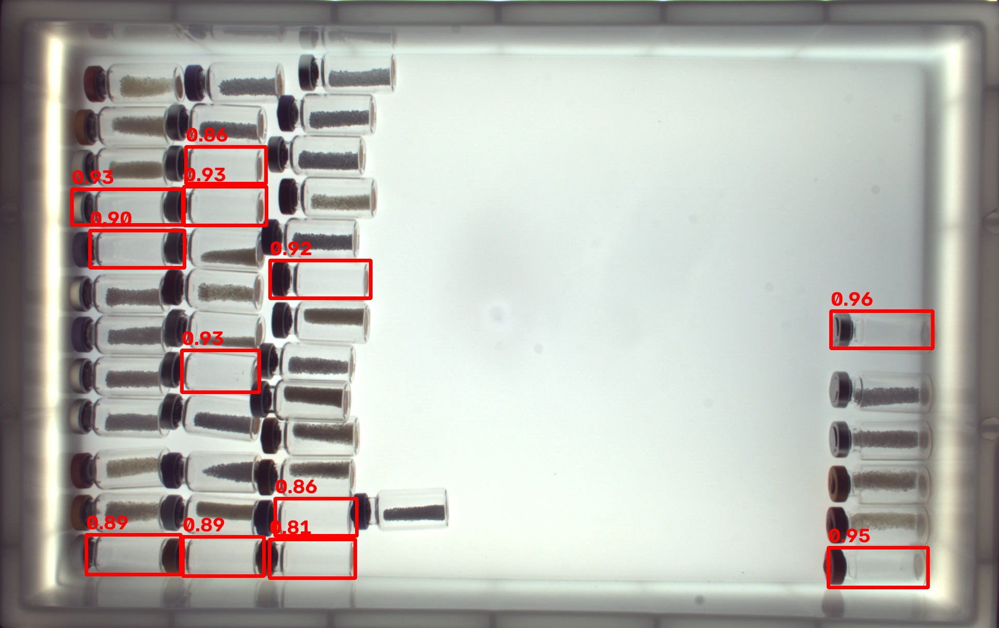
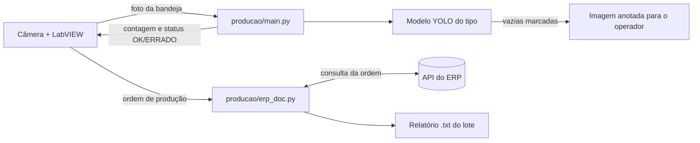

# Inspeção visual de embalagens com YOLO

Projeto Capstone: sistema de visão computacional que aponta embalagens vazias
em bandejas de ampolas e blisters. Uma câmera controlada pelo LabVIEW fotografa
a bandeja, um modelo YOLO marca as embalagens suspeitas para o operador e cada
ordem de produção é consultada no ERP, gerando um relatório por lote.

**Insper** · Projeto Capstone

| Equipe | Orientação |
|---|---|
| Enrico Islas Hlebanja<br>Giulia Siemann Piovesan<br>Luana Prado Lopes Guimarães<br>Pedro Garcia Carneiro da Cunha | Prof. Carlos Magno de Oliveira Valente |

<p align="center">
  
  <br><em>Saída do sistema: ampolas vazias marcadas em vermelho, com a confiança do modelo.</em>
</p>

## Problema e solução

Na linha de embalagem, bandejas com dezenas de ampolas ou blisters precisam ser
conferidas antes de seguir adiante: nenhuma embalagem vazia pode ser aprovada.
A conferência manual é lenta e sujeita a falhas por cansaço.

O sistema não substitui o operador; ele funciona como um **apontador visual**.
Cada foto é analisada pelo modelo do tipo de embalagem correspondente e as
embalagens vazias são destacadas na imagem. Por isso o critério de aceitação
dos modelos é **recall = 1,0 na classe vazia**: um alarme falso custa uma
conferência a mais, mas uma vazia não marcada é o erro que não pode acontecer.



## Etapas do projeto

O repositório preserva as três etapas do Capstone, cada uma em sua pasta e com
seu próprio README:

| Pasta | Etapa | Conteúdo |
|---|---|---|
| [`intermediario/`](intermediario/README.md) | Prova de conceito | Visão computacional clássica (limiar + watershed) para ampolas, pré-rotulagem e primeiro treino YOLO |
| [`final/`](final/README.md) | Desenvolvimento dos modelos | Datasets rotulados, treino e validação de um modelo YOLO por tipo de embalagem |
| [`producao/`](producao/README.md) | Implantação | Inferência chamada pelo LabVIEW e integração com o ERP |

A etapa intermediária mostrou que a abordagem clássica localiza as ampolas,
mas depende de parâmetros calibrados foto a foto e não distingue vazia de cheia.
Isso motivou a troca por um detector treinado (YOLOv8n), que na etapa final foi
estendido para cinco tipos de embalagem e depois integrado à linha.

## Resultados

Métricas no conjunto de validação (20% das fotos de cada tipo) dos modelos
atualmente em `producao/modelos/`, na última época de treino:

| Tipo | Fotos | Precision | Recall | mAP50 | mAP50-95 |
|---|---:|---:|---:|---:|---:|
| `ampola` | 83 | 0,999 | 1,000 | 0,995 | 0,816 |
| `blister_992` | 31 | 0,996 | 1,000 | 0,995 | 0,968 |
| `blister_bloco` | 55 | 0,997 | 1,000 | 0,995 | 0,876 |
| `blister_org` | 69 | 0,997 | 1,000 | 0,995 | 0,889 |
| `blister_org2` | 83 | 0,926 | 0,955 | 0,957 | 0,874 |

O histórico completo de treinos, a análise por limiar de confiança e os
experimentos (como a correção flat-field do `blister_992`) estão em
[`final/README.md`](final/README.md).

## Estrutura do repositório

```text
capstone/
├── intermediario/          # prova de conceito: visão clássica e primeiro YOLO
├── final/
│   ├── dataset/            # fotos e rótulos originais (formato YOLO)
│   ├── dataset_yolo/       # split treino/val gerado (fora do Git)
│   ├── modelos/<tipo>/     # resultados de treino e validação de cada tipo
│   └── scripts_comuns/     # organizar_dataset, treinar, validar, inspecionar
├── producao/
│   ├── main.py             # inspeção de uma foto (chamado pelo LabVIEW)
│   ├── erp_doc.py          # consulta ao ERP e relatório do lote
│   ├── inspecionar.py      # inferência e marcação das embalagens vazias
│   ├── modelos/<tipo>/     # best.pt em uso
│   └── exemplos/           # fotos de exemplo e suas saídas anotadas
├── .env.example            # modelo de configuração do ERP
└── requirements.txt        # ambiente completo (inclui as três etapas)
```

Tipos de embalagem: `ampola`, `blister_992`, `blister_bloco`, `blister_org` e
`blister_org2`.

## Instalação

Requer Python 3.12. No Windows (PowerShell), a partir da raiz do
repositório:

```powershell
python -m venv .venv
.venv\Scripts\Activate.ps1
pip install -r requirements.txt
```

Para instalar uma única etapa, use o `requirements.txt` da pasta dela. No
computador do LabVIEW basta o de `producao/`.

## Configuração

A chave da API do ERP fica em um arquivo `.env`, fora do Git:

```powershell
Copy-Item .env.example .env
```

Preencha `ERP_API_KEY` com a chave fornecida pela TI e confira a `ERP_API_URL`.
Se só a pasta `producao/` for instalada, coloque o `.env` dentro dela.

| Variável | Obrigatória | Descrição |
|---|---|---|
| `ERP_API_KEY` | Sim | Chave de acesso à API do ERP |
| `ERP_API_URL` | Sim | URL da consulta de ordem; deve conter `{numero_da_ordem}` |
| `ERP_API_TIMEOUT_S` | Não | Tempo máximo de espera da API, em segundos (padrão: 10) |

## Uso rápido

Inspecionar uma foto com o modelo em produção (o tipo vem do nome da pasta da
foto):

```powershell
python producao/main.py "C:\Fotos\Ampola\foto.png"
# 8;2;ERRADO;   ->  8 embalagens contadas, 2 vazias
```

Treinar e validar um tipo do zero:

```powershell
python final/scripts_comuns/organizar_dataset.py --input final/dataset/DATASET_ampola --out final/dataset_yolo/ampola --val-frac 0.2
python final/scripts_comuns/treinar.py --tipo ampola --epochs 100 --nome treino_completo_v2
python final/scripts_comuns/validar.py --tipo ampola --pesos treino_completo_v2/weights/best.pt
```

Os detalhes de cada etapa, incluindo a interface com o LabVIEW e o formato do
relatório, estão nos READMEs das pastas.

## Tecnologias

- [Ultralytics YOLOv8](https://docs.ultralytics.com/) (detecção de objetos, modelo `yolov8n`)
- OpenCV, NumPy, SciPy e scikit-image (visão clássica e pós-processamento)
- LabelImg (rotulagem)
- LabVIEW (`System Exec.vi`) para câmera e interface do operador
- API REST do ERP TOTVS Datasul
