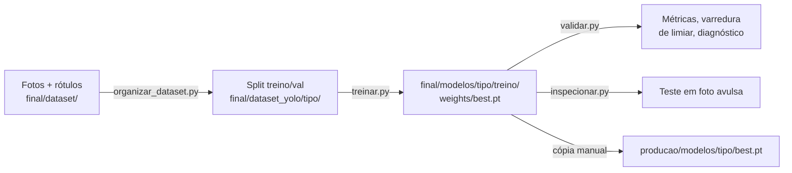

# Etapa final: modelos YOLO por tipo de embalagem

Nesta etapa a abordagem validada na [etapa intermediária](../intermediario/README.md)
foi estendida para todos os produtos da linha: um modelo YOLOv8n por tipo de
embalagem, cada um com duas classes (`<tipo>_vazio` e `<tipo>_com_produto`).

Todos os comandos rodam **a partir da raiz do repositório**.

## Fluxo de trabalho



| Script | O que faz |
|---|---|
| [`organizar_dataset.py`](scripts_comuns/organizar_dataset.py) | Separa os pares foto + rótulo em treino/validação (semente fixa) e gera o `data.yaml`. As classes são lidas do `classes.txt` da pasta de origem |
| [`treinar.py`](scripts_comuns/treinar.py) | Treina um tipo a partir do `yolov8n.pt` pré-treinado no COCO; usa GPU NVIDIA se houver |
| [`validar.py`](scripts_comuns/validar.py) | Gera os relatórios de validação descritos abaixo |
| [`inspecionar.py`](scripts_comuns/inspecionar.py) | Roda um modelo em desenvolvimento numa foto e marca as vazias, para conferência visual antes de colocá-lo em produção |

```powershell
python final/scripts_comuns/organizar_dataset.py --input final/dataset/DATASET_ampola --out final/dataset_yolo/ampola --val-frac 0.2
python final/scripts_comuns/treinar.py --tipo ampola --epochs 100 --nome treino_completo_v2
python final/scripts_comuns/validar.py --tipo ampola --pesos treino_completo_v2/weights/best.pt
python final/scripts_comuns/inspecionar.py --tipo ampola --imagem foto.png --pesos final/modelos/ampola/treino_completo_v2/weights/best.pt
```

Para colocar um modelo em uso, copie o `best.pt` escolhido para
`producao/modelos/<tipo>/best.pt`.

## Datasets

As fotos foram capturadas pela câmera da linha (1936 × 1216 px; algumas são
recortes da região da bandeja) e rotuladas no LabelImg, no formato YOLO (um
`.txt` por foto, com uma caixa por embalagem).

| Pasta em `dataset/` | Tipo | Fotos | Caixas vazias | Caixas com produto |
|---|---|---:|---:|---:|
| `DATASET_ampola` | `ampola` | 83 | 739 | 3.384 |
| `DATASET_Blister_992` | `blister_992` | 31 | 105 | 159 |
| `DATASET_Blister_992_flat-field` | `blister_992_ff` | 31 | 105 | 160 |
| `DATASET_Blister-Bloco` | `blister_bloco` | 55 | 56 | 144 |
| `DATASET_Blister-org` | `blister_org` | 69 | 117 | 354 |
| `DATASET_Blister-org2` | `blister_org2` | 83 | 57 | 686 |

`DATASET_Blister_992_flat-field` contém as mesmas fotos do `blister_992` após
correção flat-field (normalização da iluminação). As subpastas `992/` e
`Flats_orig/` dentro de `DATASET_Blister-org2` guardam imagens de referência de
captura e não entram no treino, pois o `organizar_dataset.py` lê apenas os
arquivos da raiz da pasta.

## Critério de validação

O sistema é um apontador visual para o operador, não uma aprovação automática.
Por isso a métrica que decide se um modelo serve é o **recall da classe vazia**:

- **Falso positivo** (embalagem boa marcada como vazia): custa uma conferência a
  mais do operador.
- **Falso negativo** (embalagem vazia não marcada): passaria adiante; é o erro
  que não pode acontecer.

O `validar.py` produz quatro relatórios:

1. **Resumo geral**: precision, recall e mAP por classe no ponto de operação
   padrão do Ultralytics. Os gráficos ficam em `modelos/<tipo>/validacao*/`.
2. **Varredura de limiar** da classe vazia (conf de 0,05 a 0,95): recall,
   precision, TP, FP e FN em cada ponto, recomendando o maior limiar que ainda
   mantém recall = 1,0.
3. **Accuracy caixa a caixa**, com pareamento por IoU feito separadamente em
   cada classe.
4. **Diagnóstico dos falsos negativos**: para cada vazia não detectada, lista as
   previsões que se sobrepõem a ela e salva a foto inteira e um recorte ampliado
   em `modelos/<tipo>/diagnostico_erros/`.

Em produção o limiar da classe vazia é mantido baixo (`conf_vazia = 0,05`) para
priorizar o recall, enquanto as demais embalagens são contadas com
`conf_padrao = 0,25`.

## Treinos realizados

Todos partem do `yolov8n.pt` com imagens de 640 px. Métricas da última época,
lidas do `results.csv` de cada treino (conjunto de validação, todas as classes).

| Tipo | Treino | Épocas | Precision | Recall | mAP50 | mAP50-95 | Em produção |
|---|---|---:|---:|---:|---:|---:|:---:|
| `ampola` | `treino_completo` | 100 | 0,994 | 0,995 | 0,995 | 0,836 | |
| `ampola` | `treino_completo_v2` | 100 | 0,999 | 1,000 | 0,995 | 0,816 | ✔ |
| `blister_992` | `treino_preliminar` | 100 | 0,884 | 0,915 | 0,993 | 0,942 | |
| `blister_992` | `treino_completo` | 200 | 0,998 | 1,000 | 0,995 | 0,951 | |
| `blister_992` | `treino_completo_ff` | 200 | 0,996 | 1,000 | 0,995 | 0,968 | ✔ |
| `blister_992` | `treino_completo_v2` | 100 | 0,919 | 0,973 | 0,988 | 0,864 | |
| `blister_bloco` | `treino_completo` | 100 | 0,997 | 1,000 | 0,995 | 0,876 | ✔ |
| `blister_org` | `treino_completo` | 100 | 0,997 | 1,000 | 0,995 | 0,889 | |
| `blister_org` | `treino_completo_v2` | 100 | 0,997 | 1,000 | 0,995 | 0,889 | ✔ |
| `blister_org2` | `treino_completo` | 100 | 0,926 | 0,955 | 0,957 | 0,874 | |
| `blister_org2` | `treino_completo_v2` | 100 | 0,926 | 0,955 | 0,957 | 0,874 | ✔ |

Observações:

- **Flat-field (`blister_992`)**: o `treino_completo_ff` usa o dataset com
  correção de iluminação. Na validação ([`validacao_ff.txt`](modelos/blister_992/validacao_ff.txt))
  alcançou recall 1,0 na classe vazia em todos os limiares até 0,90 e nenhum
  falso negativo. A pasta `validacao-2_fundo_escuro` contém a validação com
  fotos de fundo escuro.
- Nos tipos `blister_org` e `blister_org2`, o `treino_completo_v2` repetiu o
  treino com as mesmas configurações e reproduziu as mesmas métricas.
- O `treino_preliminar` do `blister_992` foi o primeiro teste desse tipo, feito
  antes da padronização dos scripts (`batch = 16`).

## Conteúdo de `modelos/<tipo>/`

| Item | Conteúdo |
|---|---|
| `<treino>/weights/best.pt` | Pesos da melhor época |
| `<treino>/results.csv`, `results.png` | Perdas e métricas por época |
| `<treino>/args.yaml` | Hiperparâmetros usados no treino |
| `<treino>/confusion_matrix*.png`, `Box*_curve.png` | Gráficos do Ultralytics |
| `validacao*/` | Gráficos de cada rodada do `validar.py` |
| `diagnostico_erros/` | Recortes dos falsos negativos (quando houver) |

Imagens de lote (`train_batch*.jpg`, `val_batch*.jpg`) e `last.pt` não são
versionados.

## Limitações

- Os conjuntos de validação são pequenos (de 6 a 17 fotos por tipo) e as fotos
  vêm da mesma sessão de captura do treino; não há um conjunto de teste cego.
- Os modelos dependem das condições de captura (câmera, iluminação e fundo da
  bandeja). Mudanças nesse arranjo exigem novas fotos e retreino.
