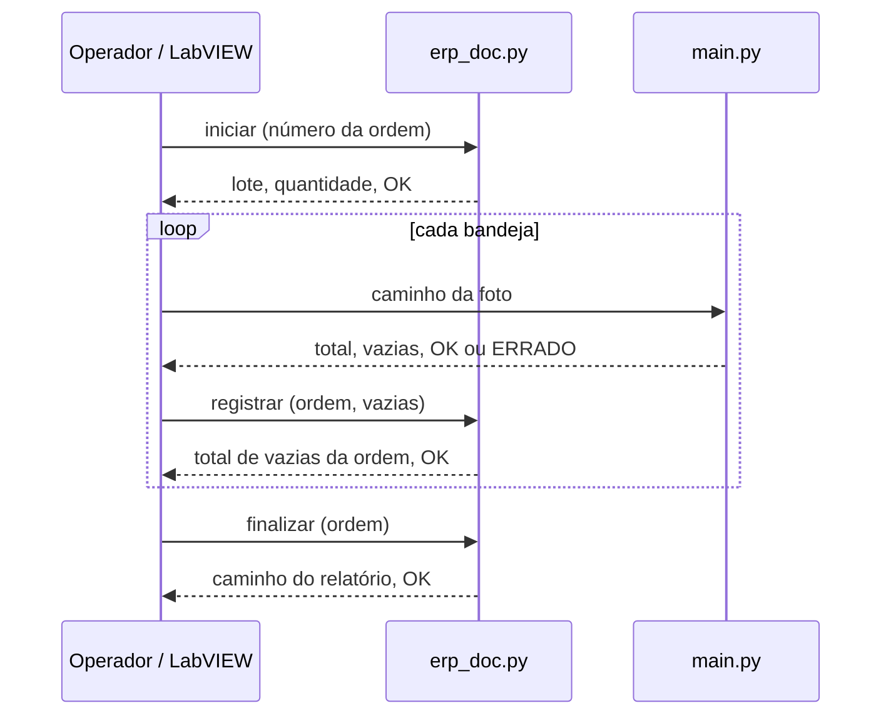

# Produção: integração com o LabVIEW e o ERP

Pacote instalado no computador da linha. O LabVIEW fotografa a bandeja e chama
os scripts desta pasta pelo `System Exec.vi`; os modelos treinados na
[etapa final](../final/README.md) ficam em `modelos/<tipo>/best.pt`.

Instalação mínima (só esta pasta): instale as dependências e crie o `.env` a
partir do [`.env.example`](../.env.example) da raiz, preenchendo
`ERP_API_KEY` e `ERP_API_URL`.

```powershell
pip install -r requirements.txt
```

## Arquivos

| Arquivo | Função |
|---|---|
| [`main.py`](main.py) | Inspeciona uma foto e devolve a contagem para o LabVIEW |
| [`inspecionar.py`](inspecionar.py) | Carrega o modelo do tipo, roda a inferência e marca as vazias. Também expõe funções para o Python Node do LabVIEW (entrada como array, sem arquivo) |
| [`erp_doc.py`](erp_doc.py) | Consulta a ordem no ERP, registra as bandejas com ausência e gera o relatório do lote |
| [`testar_api.py`](testar_api.py) | Teste interativo da API do ERP (só consulta, não grava nada) |
| `modelos/<tipo>/best.pt` | Modelo em uso de cada tipo de embalagem |
| `exemplos/<tipo>/` | Foto de exemplo e a saída anotada correspondente |

## Fluxo de uma ordem de produção



## Interface com o LabVIEW

Os scripts sempre devolvem **uma linha** no stdout, com `;` depois de cada
campo, inclusive o último. Qualquer erro vira `ERRADO`, para que o LabVIEW
nunca fique sem resposta; o detalhe do erro vai para o stderr.

| Comando | Saída com sucesso | Saída com falha |
|---|---|---|
| `python main.py "<...>\Ampola\foto.png"` | `<total>;<vazias>;OK;` (ou `ERRADO` se houver vazias) | `0;0;ERRADO;` |
| `python erp_doc.py iniciar <ordem>` | `<lote>;<quantidade>;OK;` | `;0;ERRADO;` |
| `python erp_doc.py registrar <ordem> <vazias>` | `<total_vazias>;OK;` | `0;ERRADO;` |
| `python erp_doc.py finalizar <ordem>` | `<caminho_do_txt>;OK;` | `;ERRADO;` |

No LabVIEW, a linha é separada com `Spreadsheet String To Array` (delimitador
`;`). O `;` final gera um último elemento vazio, que deve ser ignorado.

**Tipo de embalagem.** O `main.py` recebe só o caminho da foto. O tipo é deduzido
do nome da pasta onde o LabVIEW salvou a foto, que deve ser igual ao nome em
`modelos/<tipo>/` (sem diferenciar maiúsculas): `Fotos\Ampola\foto.png` usa
`modelos/ampola/best.pt`.

**Imagem anotada.** É salva na pasta irmã `<Pasta>_inspecionada`, com o mesmo
nome de arquivo (`Fotos\Ampola_inspecionada\foto.png`). As vazias recebem uma
caixa vermelha com a confiança do modelo.

**Limiares.** A classe vazia é marcada a partir de confiança 0,05 (prioridade
ao recall); as demais embalagens são contadas a partir de 0,25.

## Integração com o ERP

A API do ERP (TOTVS Datasul) é consultada com o número da ordem e o cabeçalho
`X-Api-Key`. Ela devolve o código e a descrição do item e a quantidade
aprovada; como não há número de lote separado, o lote é o próprio número da
ordem. A configuração (`ERP_API_KEY`, `ERP_API_URL`, `ERP_API_TIMEOUT_S`) é lida
do `.env` desta pasta ou da raiz do repositório.

Durante a ordem, o estado fica em `registros/ordem_<ordem>.json` (gravação
atômica, para não corromper em caso de queda de energia). Ao finalizar, o
registro é arquivado como `.finalizado.json` e o relatório é gerado em
`relatorios/ordem_<ordem>_<data>_<hora>.txt`. Exemplo ilustrativo:

```text
Número do lote: 979993201
Ordem de produção: 979993201
Código do item: 520.10
Descrição do item: FIXADOR TIPO COLLES P/ PUNHO
Quantidade inspecionada: 46
Horário de login do operador: 10/11/2026 08:02:15
Horários de detecção de ausência:
  10/11/2026 08:14:40
  10/11/2026 08:31:02
```

A quantidade inspecionada é a quantidade aprovada da ordem menos o total de
vazias detectadas. As pastas `registros/` e `relatorios/` são geradas em tempo
de execução e não são versionadas.
